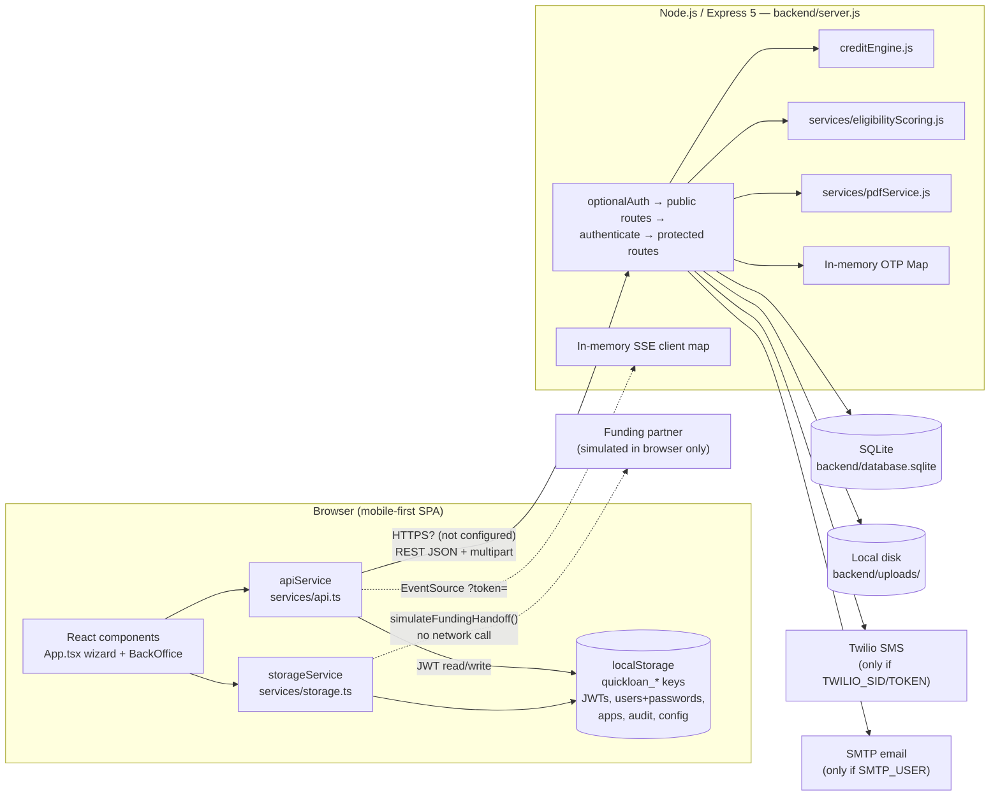
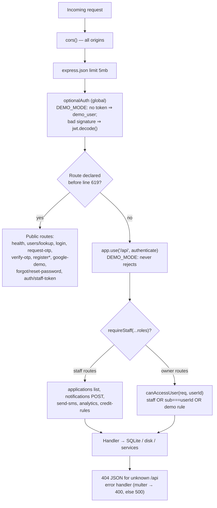
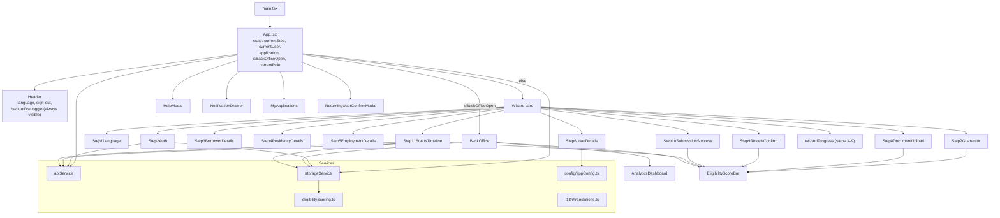
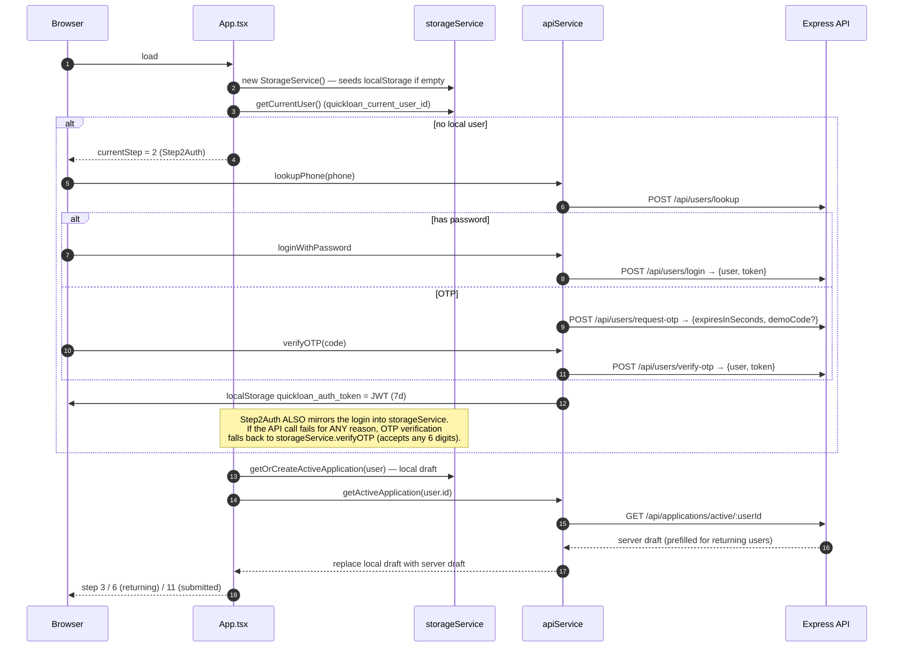
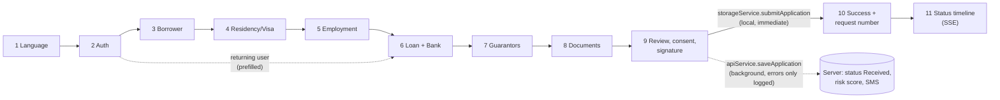
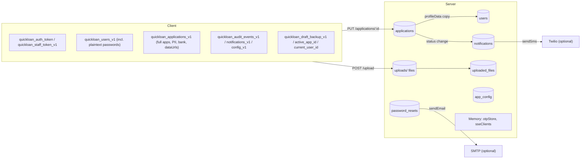

# System Architecture

Status labels: see [README.md](README.md#verification-status-legend). Every diagram below reflects **Verified** source unless a node is marked *(inferred)* or *(simulated)*.

## 1. Summary

QuickLoan is a **two-tier web application**:

1. A **React SPA** (`frontend/`) that runs entirely in the browser. It holds **two data layers**:
   - `apiService` (`src/services/api.ts`): a thin `fetch` client for the Express API.
   - `storageService` (`src/services/storage.ts`): a full **local "shadow backend"** in `localStorage`. It holds users (including passwords), applications, audit events, notifications, config, seeded demo data, local OTP generation and verification, a simulated funding hand-off, and exports.
2. An **Express 5 API** (`backend/server.js`) backed by **SQLite** (`backend/database.sqlite`), with local disk file storage (`backend/uploads/`) and optional Twilio and SMTP.

The most important architectural fact is that **the client is offline-first and optimistic, and in several flows it is authoritative.** The UI writes to `localStorage` first and syncs to the API in the background, usually swallowing errors. When the API rejects a request, several flows fall back to the local store. For a lending system this blurs the "system of record" (see [financial-integrity-risks.md](financial-integrity-risks.md)).

## 2. High-level system architecture

Notes:
- TLS is **not configured** anywhere in the repo. The UI footer text "Encrypted via TLS 1.3" (`App.tsx:458`) is not backed by any configuration (Unverified claim).
- The funding partner is **not integrated**. `storageService.simulateFundingHandoff` (`storage.ts:1233`) fabricates a success record locally.

## 3. Backend request pipeline

`*` `/api/users/register` is declared in the public section but attaches `authenticate` inline (`server.js:490`).

Key symbols: `optionalAuth` (`server.js:126`), `authenticate` (`server.js:99`), `requireStaff` (`server.js:147`), `canAccessUser` (`server.js:157`), `DEMO_MODE` (`server.js:25`).

## 4. Frontend component relationships

There is no router. Navigation is the integer `currentStep` in `App.tsx:42`. There is no global state library: state lives in `App` and is passed down as props, and `storageService` is a module singleton. See [mobile-application.md](mobile-application.md).

## 5. Startup and authentication flow

## 6. Frontend-to-backend communication

| Concern | Implementation | Evidence |
|---|---|---|
| Transport | `fetch` to `${VITE_API_URL || 'http://localhost:5000/api'}` | `api.ts:11-12, 90` |
| Auth header | `Authorization: Bearer <jwt>`. Borrower and staff tokens are kept under separate keys | `api.ts:15-16, 85-88` |
| Token where headers are impossible | `?token=` query string for `EventSource` and ``/`<a>` file URLs | `api.ts:206-219`, `server.js:94-95` |
| Error model | `{ success:false, error }` → `ApiError(message, status)`. A rejection that is not an `ApiError` counts as a network error | `api.ts:21-30, 96-98` |
| Timeouts / retries | **None** on fetch. SSE uses `retry: 5000` sent by the server | `server.js:1094` |
| Serialization | Whole `LoanApplication` objects are PUT as JSON. The server stores nested objects as TEXT JSON | `server.js:231-284` |
| Real-time | SSE `status` / `updated` events trigger a re-fetch | `Step11StatusTimeline.tsx:53-104` |

## 7. Core business workflow (borrower)

Every step's "Save & Next" calls `autoSaveDraft` (`App.tsx:108-117`). It writes to `localStorage` and then fires `PUT /api/applications/:id` with `.catch(() => {})`.

## 8. Data persistence and external integrations

Details: [database.md](database.md), [data-models.md](data-models.md), [integrations.md](integrations.md).

## 9. Architectural characteristics and constraints

| Characteristic | Assessment |
|---|---|
| Deployment topology | Single Node process with in-process state (OTP map, SSE clients). **It cannot be horizontally scaled** without moving that state out (Verified, `server.js:160, 312`) |
| Persistence | Single SQLite file, no transactions, no WAL configuration, no backups defined |
| System of record | Ambiguous. The server is the intended record (the code comments say "authoritative"), but the client decides submission success, generates the first request number, keeps its own audit log and runs the funding hand-off |
| Coupling | `server.js` is one 1300-line module containing routes, auth, persistence helpers and notification logic |
| Dual implementations | Eligibility scoring (backend JS and frontend TS, kept in sync by hand), document-reuse rules (`server.js:737` and `storage.ts:802`), OTP and auth (server and `storageService`) |
| Security boundary | Server-side checks exist (ownership, staff role on some routes, server-computed scores), but `DEMO_MODE`, which fails open, defeats most of them. See [security-and-privacy.md](security-and-privacy.md) |
