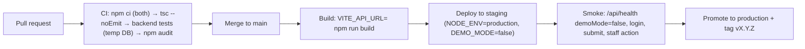

# Build and Release

> **Important:** the repository contains **no CI/CD, no deployment scripts, no Dockerfile, no hosting configuration and no release process** (Verified absent). Sections marked **[Needs team confirmation]** are recommendations, not existing procedures.

## 1. What exists

| Artifact | How it is built | Output |
|---|---|---|
| Frontend SPA | `cd frontend && npm ci && npm run build` (Vite) | `frontend/dist/` (static `index.html` plus assets) |
| Backend API | Not built. Runs from source with `node server.js` | — |

Verified on 2026-10-11: `vite build` succeeds (about 39 s, one chunk larger than 500 kB). `tsc --noEmit` **fails** (see [testing-and-qa.md](testing-and-qa.md)).

Native mobile builds (Android signing, iOS provisioning, store releases) are **Not Applicable**. This is a web app.

## 2. Versioning
- `backend/package.json` is version `1.0.0`, `frontend/package.json` is `0.0.0`. Neither is bumped or used.
- No git tags, changelog or release branches. Work happens on feature branches merged to `main` (PR #1 in history).

## 3. Recommended release pipeline [Needs team confirmation]

Minimum gates before any internet-facing deployment:
1. Phase 0 of [security-remediation-roadmap.md](security-remediation-roadmap.md) completed.
2. DEF-01 fixed and `tsc --noEmit` green.
3. Production staff authentication exists (SEC-04). Without it the back office cannot work in production.

## 4. Deployment topology constraints (from code)
- **One backend process only.** The OTP store and SSE subscribers live in memory (`server.js:160, 312`). Multiple instances would break OTP verification and live updates.
- **Persistent disk required** for `backend/database.sqlite` and `backend/uploads/`. Ephemeral container filesystems would lose data.
- A reverse proxy must terminate TLS and allow long-lived SSE responses (the server already sends `X-Accel-Buffering: no` for nginx). `app.set('trust proxy', …)` is not configured, which will matter once rate limiting or IP logging is added.
- Serve the frontend `dist/` from a static host or CDN. It calls the API at the build-time `VITE_API_URL`. CORS is currently open to all origins (restrict it, SEC-12).

## 5. Database changes during releases
Schema changes are applied **automatically on server start** by `database.js` (CREATE IF NOT EXISTS plus additive `ALTER TABLE ADD COLUMN`). Only additive column changes are safe. Anything else needs a manual migration plan. Back up the SQLite file before every deploy [Needs team confirmation: no backup procedure exists].

## 6. Secrets
Inject backend secrets (`JWT_SECRET`, Twilio, SMTP) through the host's secret manager or environment. Never in the repo and never in `VITE_*` variables. See [environment-configuration.md](environment-configuration.md).

## 7. Monitoring, crash reporting, rollback
- Crash reporting or APM: **Not Implemented**. Logs go to stdout via `console.*` only.
- Rollback: not defined. With SQLite and additive migrations, rolling back code is usually safe, but rolling back data needs file backups.
- Hotfix and incident procedures: not documented. See [operations-and-recovery.md](operations-and-recovery.md).
