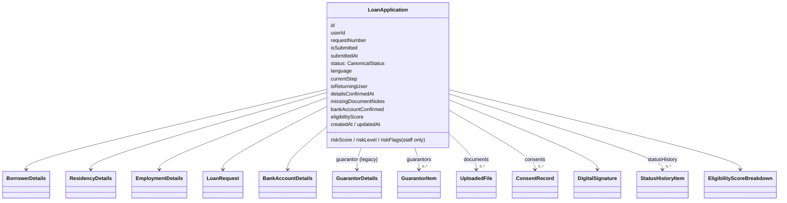

# Data Models

Canonical TypeScript types live in `frontend/src/types.ts`. The backend has no type definitions. It persists whatever JSON the client sends into the TEXT columns described in [database.md](database.md), and the only validation is described in [api-reference.md](api-reference.md).

## 1. Core domain types (`frontend/src/types.ts`)

| Type | Line | Purpose |
|---|---|---|
| `Language` | 1 | `'en' \| 'he' \| 'th' \| 'zh' \| 'tl'` (Tagalog is included; CLAUDE.md lists only four) |
| `CanonicalStatus` | 3-9 | The six application statuses |
| `UserRole` | 11-16 | `borrower` plus the four staff roles |
| `DocumentTypeCode` | 40-49 | `PASSPORT, PAY_SLIP, WORKERS_CARD, WORK_VISA, EMPLOYMENT_CONFIRMATION, BANK_STATEMENT, BANK_ACCOUNT_DOCUMENT, GUARANTOR_ID, CREDIT_CARD` |
| `UploadedFile` | 61 | Document metadata: `fileUrl`, `dataUrl?`, `qualityStatus`, `ocrStatus`, `ocrExtractedData`, `isReused`, `validityStatus`… |
| `BorrowerDetails` | 98 | Name, passport number, country, date of birth, phone, address, marital status |
| `ResidencyDetails` | 112 | Visa type and expiry, entry date, years of residency |
| `EmploymentDetails` | 119 | Employer, salary (NIS), payment method, tenure, start date |
| `LoanRequest` | 128 | Amount, purpose, period, grace, source, estimated monthly and total repayment |
| `GuarantorDetails` | 141 | Legacy single guarantor (`hasGuarantor` flag) |
| `GuarantorItem` | 151 | One entry of the multi-guarantor array |
| `EligibilityScoreBreakdown` | 167 | Output of the eligibility engine |
| `ConsentRecord` | 186 | `consentType: 'terms_and_conditions' \| 'credit_check'`, version, ip, device |
| `DigitalSignature` | 198 | `signatureMethod: 'typed_name' \| 'drawn_signature' \| 'drawn_touch'`, `signatureValue`, `signatureDataUri` |
| `StatusHistoryItem` | 209 | from, to, changedByType, changedByName, reason, createdAt |
| `NotificationItem` | 222 | |
| `AuditEvent` | 240 | **Client-only** audit record |
| `OTPCode` | 254 | **Client-only** local OTP record (`codeHash` actually holds the plaintext code) |
| `ApplicationConfig` | 264 | Business limits (see §3) |
| `BankAccountDetails` | 279 | bankName, bankCode, branchNumber, accountNumber, accountHolderName |
| `LoanApplication` | 287 | Aggregate root |
| `CreditRules` | 324 | Mirrors `DEFAULT_CREDIT_RULES` |
| `AnalyticsSummary` | 340 | `/analytics/summary` payload |
| `User` | 354 | Includes an optional `password` (used by the localStorage store) |
| `FundingIntegrationRecord` | 371 | **Simulation-only** record |

### `LoanApplication` aggregate

### Guarantor dual representation
The newer `guarantors[]` array and the legacy `guarantor` object are kept in sync **in three places**: `parseApp` (`server.js:186-210`), `writeApp` (`server.js:232-254`) and the client (`storage.ts` in `getOrCreateActiveApplication`, plus `Step7Guarantor`). `guarantors[0]` is the source of truth when the array is non-empty. Field name mapping: `idDocument` ↔ `passportPhoto`.

## 2. Serialization rules (server)

| Rule | Location |
|---|---|
| JSON object columns are parsed to `undefined` if empty or invalid | `APP_JSON_FIELDS`, `server.js:167` |
| JSON array columns are parsed to `[]` if empty or invalid | `APP_JSON_ARRAY_FIELDS`, `server.js:168` |
| `isSubmitted` and `bankAccountConfirmed` are converted from 0/1 to boolean | `server.js:175-176` |
| Null `riskScore`/`riskLevel`/`missingDocumentNotes` are removed | `server.js:177-179` |
| Missing `eligibilityScore` is computed on read | `server.js:180-184` |
| `documents[].dataUrl` is removed when `fileUrl` exists | `stripInlineFiles`, `server.js:216-224` |
| `users.password` is removed from responses, `hasPassword` is added. **`profileData` is returned as a raw JSON string** | `sanitizeUser`, `server.js:68-77` |

## 3. Business configuration (`frontend/src/config/appConfig.ts`): client only

| Key | Value | Enforced on server? |
|---|---|---|
| minLoanAmountNis / maxLoanAmountNis / amountIncrementNis | 500 / 10,000 / 500 | **No** |
| allowedRepaymentPeriodsMonths | 3, 6, 9, 12 | **No** |
| defaultInterestRatePercent | 8.5 (nominal per year) | **No** (no server pricing) |
| processingFeePercent | 1.0 | **Unused anywhere** |
| managementFeeNis | 80 | **No** |
| otpExpirationSeconds | 300 | Server uses its own `OTP_TTL_MS` (also 300 s) |
| maxFileSizeBytes | 10 MB | Server uses `MAX_UPLOAD_BYTES` (also 10 MB) |
| minBorrowerAge | 21 | **No.** The client does not read it either: Step 3 hard-codes `21` (`Step3BorrowerDetails.tsx:99-101`), so editing this value in the back office changes nothing |
| minVisaValidityMonths | 6 | **No.** The Step 4 UI also hard-codes `6` rather than reading the config |

The back-office "Config" tab edits this object **in localStorage only** (`storage.ts:1326-1338`). Changes affect only that one browser.

Static lists: `ORIGIN_COUNTRIES`, `MARITAL_STATUSES`, `SALARY_PAYMENT_METHODS`, `LOAN_PURPOSE_OPTIONS`, `REPAYMENT_SOURCE_OPTIONS`, `GUARANTOR_RELATIONSHIPS`, `LOAN_PERIOD_OPTIONS`, `GRACE_PERIOD_OPTIONS`, `VISA_TYPES`, `COUNTRY_PHONE_CODES`, `ISRAELI_BANKS`, `DOCUMENT_TYPE_CONFIG`, `STATUS_BADGE_CONFIG`.

⚠ Casing drift: `types.ts:22` defines `LoanPurpose = 'Cash flow' | …` while `appConfig.ts:42` offers `'Cash Flow'`. Analytics groups by the raw string, so the two spellings would be counted separately.

Required documents (`DOCUMENT_TYPE_CONFIG`): `PASSPORT` (required), `PAY_SLIP` (required), `BANK_ACCOUNT_DOCUMENT` (required), `GUARANTOR_ID` (required only with a guarantor), `WORKERS_CARD` (optional). This is enforced **only in the Step 8 UI**.

## Client-side stores

`localStorage` keys. **All are unencrypted and readable by any script on the origin.**

| Key | Contents | Writer |
|---|---|---|
| `quickloan_auth_token` | Borrower JWT | `authTokens.set` (`api.ts:55`) |
| `quickloan_staff_token_v1` | `{role, token}` staff JWT | `authTokens.setStaff` |
| `quickloan_users_v1` | All locally known users **including plaintext passwords** | `storageService.saveUsers` |
| `quickloan_applications_v1` | All locally known applications (PII, bank details, `dataUrl` images) plus 3 seeded demo applications (`app_seed_1..3`, `storage.ts:31-393`) | `saveApps` |
| `quickloan_active_app_id` | Current draft id | |
| `quickloan_current_user_id` | Local "session" | |
| `quickloan_audit_events_v1` | Client audit log | `logAuditEvent` |
| `quickloan_notifications_v1` | Client-generated notifications | `createNotification` |
| `quickloan_config_v1` | Edited `ApplicationConfig` | `updateConfig` |
| `quickloan_draft_backup_v1` | Last saved application | `saveApplication` |
| `quickloan_funding_integrations_v1` | Declared key; records are held only **in memory** (never persisted) | — |

### Refresh and invalidation
There is no cache invalidation protocol. The client:
- loads its local draft, then **replaces** it with the server draft from `GET /applications/active/:userId` (`App.tsx:88-103`);
- on SSE `status`/`updated`, re-fetches `GET /applications/:id` and overwrites the local copy (`Step11StatusTimeline.tsx:64-76`);
- otherwise trusts local data indefinitely, including after the server changes. The back office shows **API data when reachable, else local data** (`BackOffice.tsx:85-100`).

### Is sensitive financial data stored on the device?
**Yes (Verified).** Bank account numbers, salary, requested amounts, passport numbers and identity document images can all sit in localStorage. None of it is authoritative, because the server copy is the intended record, but the client acts on it (FIN-01).
