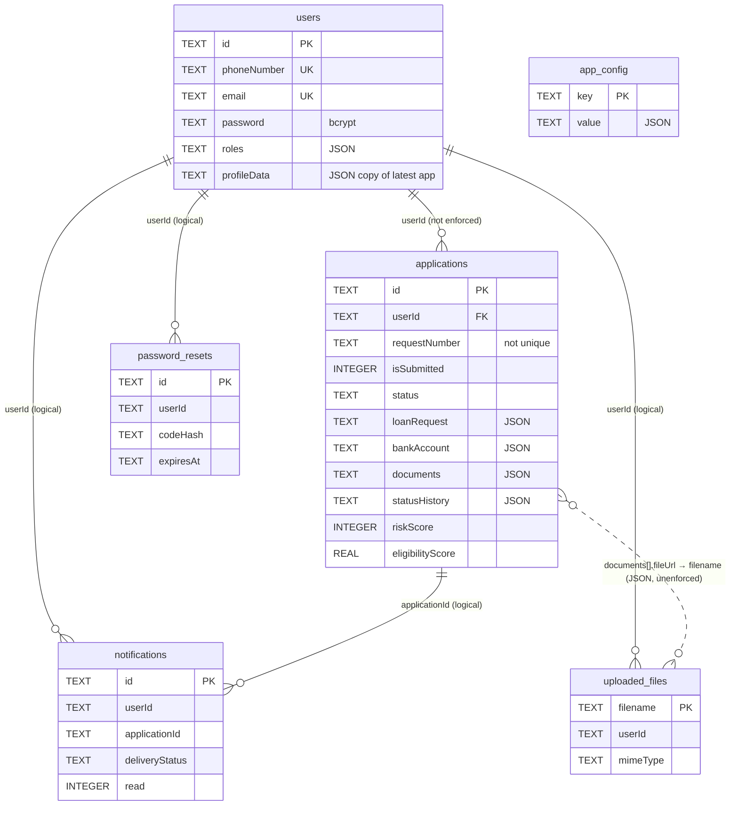

# Database

## 1. Data stores (Verified)

| Store | Kind | Location | Authoritative for |
|---|---|---|---|
| SQLite | Remote (server) relational DB | `backend/database.sqlite`, opened by `backend/database.js:4-11` | Users, applications, notifications, uploads metadata, reset codes, credit-rule config (intended system of record) |
| Upload directory | Server file storage | `backend/uploads/` (`server.js:41-42`) | Uploaded document bytes |
| `otpStore` | Server in-process `Map` | `server.js:160` | Pending login OTPs. **Lost on restart, not shared across processes** |
| `sseClients` | Server in-process `Map` | `server.js:312` | Open SSE connections |
| Browser localStorage | Client key/value | `frontend/src/services/storage.ts:18-28`, `api.ts:15-16` | JWTs. Also a **full shadow copy** of users, applications, audit log, notifications, config (see [data-models.md](data-models.md#client-side-stores)) |
| Twilio / SMTP | Third-party | Optional | Delivery only. Nothing is read back |

No caches (Redis etc.), no object storage (S3), and no third-party data stores exist. The `storageKey: "s3://quickloan-docs/..."` in `Step11StatusTimeline.tsx:130` is a **cosmetic string**. There is no S3 integration.

## 2. Schema management

- The schema is created on every startup with `CREATE TABLE IF NOT EXISTS` (`database.js:14-140`).
- Columns are added by appending `ALTER TABLE … ADD COLUMN` statements to the `addedCols` array (`database.js:62-81`). "duplicate column" errors are ignored.
- **There is no migration tool, no version table, no down-migrations and no data migrations.** Column renames, type changes, constraints or indexes cannot be added this way on existing tables. SQLite needs a table rebuild for those.
- The statements run inside `db.serialize`, but they are fire-and-forget. The server may start handling requests before the ALTERs finish. In practice this is harmless because SQLite queues them first.
- `PRAGMA foreign_keys` is **not enabled**, so the declared foreign key `applications.userId → users.id` is **not enforced**.

## 3. Tables

Type notes: SQLite is dynamically typed. "TEXT (JSON)" columns are serialised and parsed in `server.js` (`safeJson`, `parseApp`, `writeApp`). Booleans are stored as `INTEGER` 0/1. Timestamps are ISO-8601 `TEXT`.

### 3.1 `users` (`database.js:15-30`, plus `profileData` at `:72`)

| Column | Type | Constraints | Notes |
|---|---|---|---|
| id | TEXT | **PK** | `user_<ms>_<hex>` or `user_google_<ms>_<hex>` (`newId`, `server.js:54`) |
| phoneNumber | TEXT | **UNIQUE** | Normalised (spaces, parentheses and dashes stripped). `google:<email>` for demo Google users |
| email | TEXT | **UNIQUE** | Compared case-insensitively in queries, but the UNIQUE constraint is case-sensitive |
| fullName | TEXT | | Overwritten from `borrowerDetails.fullName` on each application save |
| password | TEXT | | bcrypt hash. NULL for OTP-only accounts |
| authProvider | TEXT | | `phone` · `password` · `google` |
| phoneVerifiedAt | TEXT | | |
| preferredLanguage | TEXT | | `en`/`he`/`th`/`zh`/`tl` |
| roles | TEXT (JSON) | | Always `["borrower"]`. Staff are **not** users (see SEC-04) |
| isActive | INTEGER | | Set to 1. **Never checked** at login (Verified) |
| createdAt, updatedAt | TEXT | | |
| profileData | TEXT (JSON) | | Copy of the latest application's borrower, residency, employment, bank, guarantor and document sections (`server.js:1040-1064`). Used for returning-user prefill |

### 3.2 `applications` (`database.js:32-58`, plus ALTERs `:63-71`)

| Column | Type | Notes |
|---|---|---|
| id | TEXT **PK** | `app_<ms>_<hex>` (server) or `app_<ms>_<rand>` (client) |
| userId | TEXT | FK → users.id (**not enforced**). May be `demo_user` |
| requestNumber | TEXT | `REQ-<year>-<6 digits>`. **No UNIQUE constraint** (FIN-05) |
| isSubmitted | INTEGER | 0/1 |
| submittedAt | TEXT | |
| status | TEXT | One of six canonical statuses (see [transaction-state-models.md](transaction-state-models.md)) |
| language | TEXT | |
| currentStep | INTEGER | Wizard resume point |
| borrowerDetails | TEXT (JSON) | PII: name, passport number, date of birth, phone, address, marital status |
| residencyDetails | TEXT (JSON) | Visa type and expiry, entry date |
| employmentDetails | TEXT (JSON) | Employer, salary, tenure |
| loanRequest | TEXT (JSON) | Amount, period, purpose, grace period, client-computed repayment |
| guarantor | TEXT (JSON) | Legacy single guarantor |
| guarantors | TEXT (JSON array) | Added by ALTER |
| documents | TEXT (JSON array) | Metadata plus `fileUrl`. May contain base64 `dataUrl` if the upload failed (FIN-11) |
| consents | TEXT (JSON array) | Built by the client |
| digitalSignature | TEXT (JSON) | May include a PNG data-URI |
| statusHistory | TEXT (JSON array) | Newest first |
| riskScore | INTEGER | Added by ALTER (also in CREATE) |
| riskLevel | TEXT | `Low`/`Medium`/`High` |
| riskFlags | TEXT (JSON array) | |
| missingDocumentNotes | TEXT | |
| bankAccountConfirmed | INTEGER | |
| bankAccount | TEXT (JSON) | Bank name and code, branch, **account number**, holder |
| eligibilityScore | REAL | Server-computed |
| eligibilityBreakdown | TEXT (JSON) | |
| createdAt, updatedAt | TEXT | |

Writes go through `writeApp` (`server.js:231-284`): `INSERT … ON CONFLICT(id) DO UPDATE SET` every column except `id` and `createdAt`. This makes every save a **full-row overwrite**.

### 3.3 `notifications` (`database.js:118-137`)

| Column | Type | Notes |
|---|---|---|
| id | TEXT PK | `notif_…` |
| userId | TEXT | No FK declared |
| applicationId | TEXT | |
| channel | TEXT | `sms` or `push` (push is only a label; nothing sends push) |
| notificationType | TEXT | `SUBMISSION_CONFIRMATION`, `STATUS_<status>`, `MANUAL`… |
| title, message | TEXT | |
| deliveryStatus | TEXT DEFAULT 'pending' | → `delivered`/`failed` (SMS) or `sent` |
| read | INTEGER DEFAULT 0 | |
| language | TEXT | Recorded, but message text is **always English** on the server (`server.js:346-353`) |
| createdAt | TEXT | |

### 3.4 `uploaded_files` (`database.js:106-115`)

| Column | Type | Notes |
|---|---|---|
| filename | TEXT PK | `<ms>_<16 hex><ext>` |
| userId | TEXT | Uploader (`req.auth.sub`) |
| originalName, mimeType | TEXT | Client-supplied |
| size | INTEGER | |
| createdAt | TEXT | |

There is no link to an application or document type. Orphaned files are never cleaned up.

### 3.5 `password_resets` (`database.js:84-94`)
`id` PK, `userId`, `codeHash` (SHA-256 of a 6-digit code), `expiresAt`, `attempts` DEFAULT 0, `consumedAt`, `createdAt`. Rows are never deleted.

### 3.6 `app_config` (`database.js:97-103`)
`key` PK, `value` TEXT (JSON), `updatedAt`. The only key in use is `creditRules`.

## 4. Indexes

Only the implicit indexes for PRIMARY KEY and UNIQUE columns exist (Verified: `sqlite_master` lists 8 auto-indexes and no explicit ones). These columns are queried but **not indexed**:
- `applications.userId`, `isSubmitted`, `submittedAt`, `requestNumber` (`server.js:228, 288, 733, 803, 823, 941`)
- `notifications.userId`
- `password_resets.userId`

`nextRequestNumber` and `/analytics/summary` do full scans. That is acceptable at the current size (34 rows) but will not scale.

## 5. Entity-relationship diagram

## 6. Read/write ownership

| Data | Written by | Read by |
|---|---|---|
| users | verify-otp, register, google-demo, login (hash upgrade), reset-password, PUT application (profileData, fullName) | auth routes, `/users/me`, `/applications/active` |
| applications | `PUT /applications/:id`, `GET /applications/active` (draft creation and prefill), **`/applications/:id/pdf` (SEC-02)**, `PUT /config/credit-rules` (risk columns) | all application routes, analytics |
| notifications | `createNotification` (status hook, staff POST) | notification routes |
| uploaded_files | `POST /upload` | `GET /uploads/:filename` |
| password_resets | forgot-password, reset-password | reset-password |
| app_config | `PUT /config/credit-rules` | `getCreditRules` |

## 7. Retention, deletion, backup

- **Deletion: Not Implemented.** No endpoint or job deletes users, applications, uploads, notifications or reset codes.
- **Retention policy: Not defined.**
- **Backups: Not defined.** The DB is a single file with no WAL configuration and no backup script. The committed copy in git is *not* a backup strategy, and it is itself a risk (SEC-14).
- **Encryption at rest: none.**

## 8. Tests and the live DB

The backend test scripts `require('./server')`, which opens **the same `backend/database.sqlite`**, and they insert test users and applications into it (Verified). Run them against a copy (see [testing-and-qa.md](testing-and-qa.md)).
