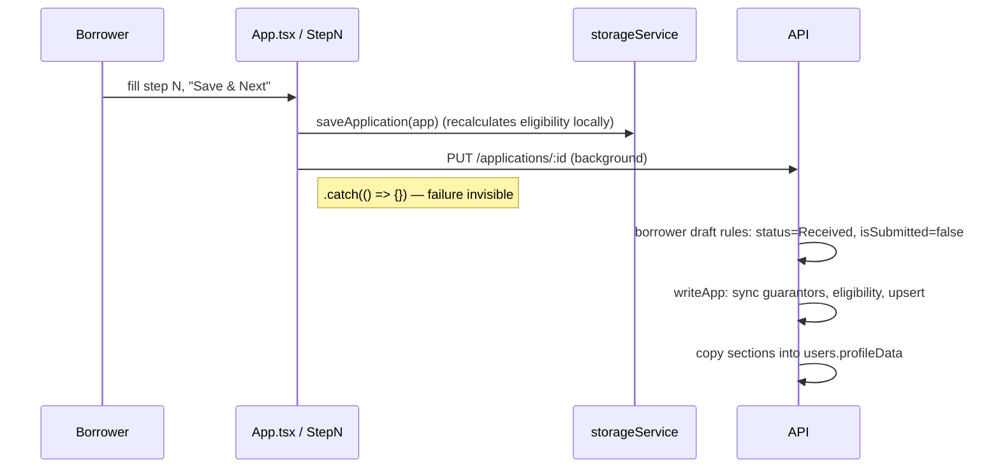
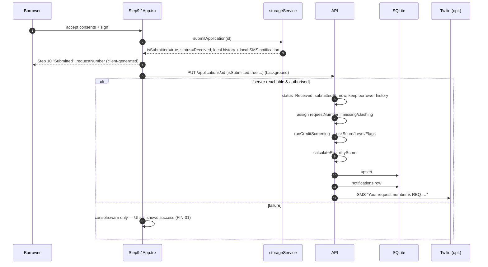

# Financial Workflows

## Which workflows exist?

| Workflow (from the brief) | Status | Notes |
|---|---|---|
| Account creation and verification | **Implemented** | Phone OTP. Password optional. See W1 |
| Loan application and quote | **Implemented** | See W2 and W3 |
| Credit pre-screen and eligibility scoring | **Implemented** (advisory) | See W4 |
| Underwriting decision (approve / reject / request docs) | **Implemented** | See W5 |
| Hand-off to funding entity | **Simulated in browser** | See W6 |
| Wallet creation, balances | Not Implemented | |
| Deposits, withdrawals, transfers | Not Implemented | |
| Disbursement of loan funds | Not Implemented | Bank details are collected, nothing is paid out |
| Repayment collection, schedules, arrears | Not Implemented | Only an estimate is displayed |
| Payments, refunds, card processing | Not Implemented | |
| Fees charged | Not Implemented | Fees appear in the quote only |
| Currency conversion | Not Implemented | NIS only, implied by field names |
| Settlement and reconciliation | Not Implemented | |
| Transaction notifications | Implemented for **application status** | See W5 |

The sections below follow the 10-point template from the brief. Integrity weaknesses are cross-referenced to [financial-integrity-risks.md](financial-integrity-risks.md).

---

## W1: Account creation and phone verification

| # | Aspect | Detail |
|---|---|---|
| 1 | Trigger | `Step2Auth.tsx`: phone entry, then `apiService.lookupPhone`, then `requestOtp` or the password form |
| 2 | Client validation | Phone format per country code, 6-digit OTP. Password rules shown in the UI (`isPasswordValid`) |
| 3 | Backend | `request-otp` → `verify-otp` creates the user (`server.js:428-487`). Optional `register` sets a password (`:490-519`) |
| 4 | Records | `users` row. OTP held in memory |
| 5 | States | No user → user (phone verified) → user with password |
| 6 | Feedback | JWT stored and the wizard advances to step 3 |
| 7 | Errors | 400 expired or incorrect code, 429 too many attempts. **Any error triggers the local fallback** (SEC-05) |
| 8 | Retry | Resend button calls request-otp again (resets attempts; no rate limit, SEC-08) |
| 9 | Duplicates | `phoneNumber` UNIQUE. verify-otp is safe to repeat |
| 10 | Audit | Client localStorage audit events only (`USER_REGISTERED`, `PHONE_AUTHENTICATED`). No server audit |

## W2: Loan application drafting



| # | Aspect | Detail |
|---|---|---|
| 1 | Trigger | `autoSaveDraft` (`App.tsx:108-117`) on every step |
| 2 | Client validation | Per-step forms: age ≥ 21, a **hard-coded literal** that does not read `minBorrowerAge` (`Step3BorrowerDetails.tsx:99-101`); visa ≥ 6 months, also hard-coded (Step 4); bank fields required (Step 6); required documents (Step 8) |
| 3 | Backend | `PUT /applications/:id`, draft branch (`server.js:1018-1022`) |
| 4 | Records | `applications` row (`isSubmitted=0`). `users.profileData` updated |
| 5 | States | Draft only (`status` is forced to `Received` while `isSubmitted=0`) |
| 6 | Feedback | "Draft saved" toast. This reflects the **local** save only |
| 7 | Errors | Swallowed. The server may silently hold an older draft |
| 8 | Recovery | `quickloan_draft_backup_v1`. Server draft adopted on next login |
| 9 | Duplicates | Upsert by `id`. Client and server can create different draft ids (FIN-14) |
| 10 | Audit | None on the server |

**Returning users.** `GET /applications/active/:userId` prefills from `profileData` or the previous application. It reuses documents only if they are still valid (visa at least 6 months left, pay slip under 90 days old, `server.js:737-793`), and starts the wizard at step 6. `ReturningUserConfirmModal` then lets the borrower confirm or update the passport number, employer, salary and bank details (`App.tsx:507-543`).

## W3: Repayment quote (Step 6)

Formula: `calculateLoanRepayment` (`frontend/src/config/appConfig.ts:200-241`), **client only**.

```
r        = 8.5 / 100 / 12                     (nominal monthly rate)
factor   = (1 + r)^n                          (n ∈ {3,6,9,12})
P&I      = round( P · r · factor / (factor − 1) )
feePart  = round( 80 / n )                    (₪80 management fee spread evenly)
monthly  = P&I + feePart
total    = monthly · n
interest = total − P − 80
```

Worked example (computed by running the formula above in Node on 2026-10-11, not observed in the UI): P = ₪5,000, n = 6 → r ≈ 0.0070833. P&I = round(854.11) = 854, feePart = round(13.33) = 13, **monthly = ₪867**, total = ₪5,202, "interest" = ₪122.

Known gaps (FIN-03): the grace period is ignored, `processingFeePercent` (1%) is unused, it is labelled "APR" although fees are excluded, there is no server recomputation, and the amount input is not clamped to the limits (FIN-04).

## W4: Submission, pre-screen and eligibility scoring



| # | Aspect | Detail |
|---|---|---|
| 1 | Trigger | `Step9ReviewConfirm` → `App.handleSubmitApplication` (`App.tsx:249-265`) |
| 2 | Client validation | Consents ticked, signature drawn or typed |
| 3 | Backend | First-submission branch (`server.js:1008-1017`), request number (`:1026-1032`), `applyRiskScore` (`:1035`), `writeApp`, `notifyStatusChange` (`:1069-1072`) |
| 4 | Records | `applications` (`isSubmitted=1`, risk and eligibility columns), `notifications`, `users.profileData` |
| 5 | States | Draft → `Received` |
| 6 | Feedback | Step 10 with request number and confetti. SMS from the server, plus a duplicate local notification |
| 7 | Errors / timeouts | **Not surfaced** (FIN-01). There is no fetch timeout |
| 8 | Retry | None automatic. A later save of the same object would re-PUT it, and the server treats it as a first submission if the earlier one never arrived |
| 9 | Duplicates | Local: `if (app.isSubmitted) return app`. Server: a resubmit after a successful submit keeps the frozen fields. **But `bankAccount`, `bankAccountConfirmed` and `documents` are not frozen and stay borrower-editable after submission** (FIN-17). No idempotency key |
| 10 | Audit | `statusHistory[0]` (borrower-authored). Client audit `APPLICATION_SUBMITTED` |

**Credit pre-screen** (`creditEngine.js`). This is advisory and never blocks a submission. Start at 100: salary × 6 must cover the amount (−40 if not, −15 if marginal), visa must outlast term + 3 months (−25), job tenure (−20 if under 3 months, −10 if under 6), guarantor (+10). The result is clamped to 0–100: ≥80 Low, ≥50 Medium, otherwise High. Thresholds are configurable (`PUT /config/credit-rules`). See [modules/credit-prescreening.md](modules/credit-prescreening.md).

**Eligibility score** (`services/eligibilityScoring.js`, mirrored in the frontend). Five factors of 20 points each: identity plus valid visa; salary (≥7,500 → 20, >0 → 10); employment duration (≤12 months → 5, ≤24 → 10, ≤36 → 15, >36 → 20); visa validity (≥12 months → 20, ≥6 → 10, ≥3 → 5); guarantors (1 → 10, ≥2 → 20). See [modules/guarantors-and-eligibility.md](modules/guarantors-and-eligibility.md).

## W5: Underwriting decision and status notifications

| # | Aspect | Detail |
|---|---|---|
| 1 | Trigger | `BackOffice` inspector buttons: Approve, Request Document, Reject (`BackOffice.tsx:1032-1080`) |
| 2 | Client validation | Buttons shown by role (UI only). Reason text optional |
| 3 | Backend | `PUT /applications/:id` staff branch: **whole-object overwrite, any status** (`server.js:975-977`). Status-change hook (`:1070-1072`) |
| 4 | Records | `applications.status`, `statusHistory` (built by the **client**), `missingDocumentNotes`, `notifications` row |
| 5 | States | See [transaction-state-models.md](transaction-state-models.md) |
| 6 | Feedback | Staff toast. Borrower gets an SMS (English, `STATUS_MESSAGES`, `server.js:346-353`) and an SSE `status` event, which makes Step 11 re-fetch |
| 7 | Errors | API failure gives `console.warn('Backend sync failed, saved locally')`, but the toast still says "updated" |
| 8 | Retry | None |
| 9 | Duplicates / concurrency | Stale overwrites possible (FIN-06) |
| 10 | Audit | Client-supplied history entry with a synthetic actor name (FIN-08, SEC-03) |

⚠ `storageService.updateApplicationStatus` throws `Application not found` if the application exists only on the server and not in this browser's localStorage. The back office loads server data into React state without saving it locally (`BackOffice.tsx:89-91` vs `storage.ts:1114-1115`), so **status changes from a fresh staff browser are likely to fail** (DEF-04, Suspected; not executed).

**Borrower resubmission:** Step 11 lets the borrower upload a requested document. The client sets the status to `Under Review` (`Step11StatusTimeline.tsx:143-153`), and the server allows exactly that borrower transition (`server.js:988-1002`). See FIN-10.

## W6: Funding hand-off (simulated)

`BackOffice.handleFundingHandoff` → `storageService.simulateFundingHandoff` (`storage.ts:1233-1266`):
1. Creates an in-memory `FundingIntegrationRecord` with a **random** external reference and `status: 'success'`. There is no network I/O.
2. Calls `updateApplicationStatus(…, 'Forwarded to Funding Entity', 'funding_entity', …)`.
3. PUTs the application to the server as staff, so the server stores the new status and sends the borrower an SMS: "sent to our funding partner for disbursement".

**No funds move. Nothing reaches a funding partner.** See FIN-07.

## Exports
- **CSV** (`storage.ts:1281-1320`): built from **local** applications only, with no escaping of embedded quotes, newlines or leading `=`/`+`/`-`/`@`. It includes passport numbers. This is a CSV/formula-injection and data-minimisation concern.
- **"Signed JSON"** (`storage.ts:1268-1279`): the "digest" is random text, not a hash or signature (FIN-07).
- **PDF** (server): see [modules/pdf-export.md](modules/pdf-export.md).
