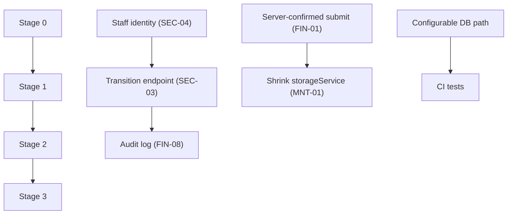

# Improvement Roadmap

The order is driven by risk and impact. IDs refer to [technical-debt.md](technical-debt.md). Effort sizes are indicative (S ≤ 1 day, M ≤ 1 week, L > 1 week) and need confirmation by the team.

## Stage 0: Unblock and contain (days)

| Item | IDs | Effort |
|---|---|---|
| Fix the missing imports so Steps 7 and 8 render. Make `tsc --noEmit` green | DEF-01, DEF-02 | S |
| Invert DEMO_MODE (opt-in) and remove the `jwt.decode` fallback and anonymous `demo_user` | SEC-01 | S |
| Make the PDF route read-only | SEC-02 | S |
| Sign-out clears the JWT and all `quickloan_*` keys | SEC-07 | S |
| Decide on `database.sqlite` (untrack, check for real data) | SEC-14 | S–M |
| Fix the test date fixtures | DEF-06 | S |
| Remove or relabel misleading UI: "TLS 1.3" footer, "pushed to Bank Leumi", fake digest, placeholder KPIs | SEC-12, FIN-07, FIN-16 | S |

## Stage 1: Make the server the system of record (weeks)

| Item | IDs | Effort |
|---|---|---|
| Server-confirmed submission with an idempotency key. The UI shows success only after a 2xx and shows the server request number | FIN-01, FIN-02 | M |
| Server-side validation of lending rules, sharing one rules module or config with the client | FIN-04 | M |
| Request numbers: UNIQUE index plus allocation in a transaction | FIN-05, MNT-12 | S |
| Dedicated status-transition endpoint (role × state matrix, server-built history), version precondition | SEC-03, FIN-06, DEF-07 | M |
| Server audit-log table | FIN-08 | M |
| Remove client-side auth and the password store. Shrink `storageService` to a draft cache | SEC-05, SEC-06, MNT-01 | M–L |
| Block wizard progress until uploads are confirmed. Validate document ownership on the server at submission | FIN-11, FIN-10 | M |
| Rate limiting and anti-abuse on auth and upload endpoints | SEC-08 | M |
| Fix PDF signature rendering. Add a Unicode font | DEF-03, DEF-10 | S |

## Stage 2: Production readiness (1–2 months)

| Item | IDs | Effort |
|---|---|---|
| Real staff identity (SSO/OIDC or accounts with MFA) | SEC-04 | L |
| Session hardening: short access tokens, refresh, revocation, no tokens in URLs | SEC-07, SEC-11 | M |
| Upload hardening and storage (signed URLs, safe Content-Type, quotas, encryption) | SEC-10, SEC-16 | M |
| CORS allow-list, helmet and CSP, TLS proxy | SEC-12 | S–M |
| Server-side quote engine with versioned pricing, correct cost-of-credit disclosure, grace period and fees | FIN-03 | M |
| Server-recorded consent | SEC-19 | S–M |
| Data retention, deletion and data-subject access | SEC-16 | M |
| CI pipeline: type-check, tests on a temp DB, `npm audit`. Configurable DB path | MNT-05 | M |
| Backups, health and readiness checks, structured logging, error tracking | ops | M |

## Stage 3: Scale and maintainability (ongoing)

| Item | IDs | Effort |
|---|---|---|
| Split `server.js` into routes, services and repositories. Introduce schema validation (e.g. zod) | MNT-02 | L |
| Migration runner. Consider moving from SQLite to a managed RDBMS. Externalise OTP and SSE state (e.g. Redis) for horizontal scaling | MNT-04 | L |
| Single source for eligibility scoring, or golden tests shared by both engines | MNT-03 | M |
| Frontend tests (Vitest + RTL), E2E (Playwright), translation completeness check | MNT-05 | M |
| Localise SMS. Move hard-coded strings to i18n | DEF-11, MNT-09 | M |
| Code-split the back office. Remove seed data and unused deps from production | MNT-07, MNT-11 | S |
| Real integrations as needed: KYC/OCR provider, credit bureau, funding partner (server-side, with persisted request/response, retries and reconciliation) | FIN-07, FIN-09 | L |

## Dependencies

## Open questions for the existing team / product owner
1. Is any data in the committed `database.sqlite` real?
2. Was the app ever deployed with `NODE_ENV` other than `production`? Where, and is it reachable from the internet?
3. Is offline-first submission a product requirement? It drives how much of `storageService` must survive.
4. Who is the intended funding partner, and is there an API specification?
5. Which lending licence and regulatory regime applies? This decides the disclosure, consent and record-keeping requirements.
6. Should the back office be a separate app or route with its own auth, rather than a toggle in the borrower UI?
7. Should `tl` (Tagalog) be fully supported? It is in the code and `metadata.json`, but CLAUDE.md lists four languages.
