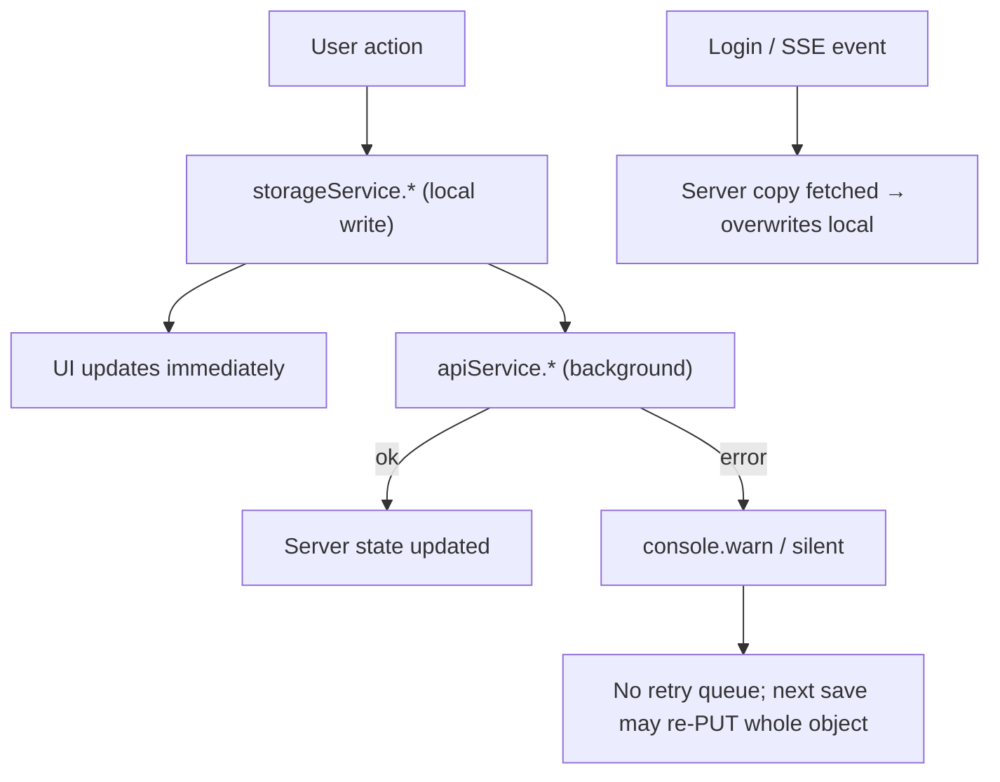

# Client Application (Mobile-First Web SPA)

> **Platform:** this is a browser SPA (React 19 + Vite + Tailwind v4), designed for phone screens. There is **no native Android or iOS app**, and no Flutter or React Native code (Verified). Where the brief asks about native concerns, this document gives the web equivalent or marks the item Not Applicable.

## 1. Startup and initialization

1. `frontend/index.html` loads `src/main.tsx`, which renders `<App />` inside `React.StrictMode` (10 lines).
2. Importing `services/storage.ts` constructs the `storageService` singleton (`storage.ts:1340`). `init()` loads every `quickloan_*` key, or **seeds 3 demo applications and 2 demo users** if the keys are absent (`storage.ts:407-471`).
3. `App` state is initialised (`App.tsx:39-50`). `currentUser` comes from `storageService.getCurrentUser()`, i.e. the local session key, **not** from JWT validity. `currentStep` is 3 when a local user exists, otherwise 2. Step 1 (Language) is reachable only through Back.
4. Effects:
   - online/offline listeners (`App.tsx:53-62`)
   - `<html lang dir>` update; Hebrew sets `dir="rtl"` (`App.tsx:65-68`)
   - when `currentUser` changes: load or create the local draft, then fetch the server draft (`App.tsx:71-105`).

## 2. Navigation

- **No router and no URLs per screen.** `currentStep` (1–11) in `App.tsx` decides what renders (`App.tsx:333-451`). A browser refresh restores the step from `application.currentStep` in localStorage.
- Step map:

| Step | Component | Purpose |
|---|---|---|
| 1 | `Step1Language` | Choose en / he / th / zh / tl |
| 2 | `Step2Auth` | Sign in or register (phone OTP, password, mock Google, forgot password) |
| 3 | `Step3BorrowerDetails` | Personal details. Age check. Local duplicate-passport check |
| 4 | `Step4ResidencyDetails` | Visa type and expiry (at least 6 months left), entry date |
| 5 | `Step5EmploymentDetails` | Employer, salary, tenure |
| 6 | `Step6LoanDetails` | Amount, period, purpose, grace period, repayment source, live quote, bank account |
| 7 | `Step7Guarantor` | 1 to 3 guarantors with ID upload |
| 8 | `Step8DocumentUpload` | Required documents, camera capture, simulated quality and OCR |
| 9 | `Step9ReviewConfirm` | Review, consents, drawn or typed signature |
| 10 | `Step10SubmissionSuccess` | Request number, PDF download |
| 11 | `Step11StatusTimeline` | Status timeline, SSE, missing-document re-upload, PDF, start a new application |

- Overlays: `HelpModal`, `NotificationDrawer`, `MyApplications`, and `ReturningUserConfirmModal` (shown when `isReturningUser && !detailsConfirmedAt && !isSubmitted`).
- **Back office:** the `Header` toggle (`Header.tsx:163-179`) swaps the whole wizard for `BackOffice`. It is **visible to every visitor**, and the role is picked from a dropdown.
- **Deep links / universal links:** Not Implemented.

## 3. Layers

| Layer | Where | Notes |
|---|---|---|
| Presentation | `components/*.tsx` | Large components: `Step2Auth` 1608 lines, `BackOffice` 1099. Tailwind classes inline. `motion` for animation |
| State | React `useState` in `App` and components. **No Redux, Zustand or Context** (Verified: no such imports) | Props passed down. `onSaveAndNext` callbacks bubble up |
| Business logic | `config/appConfig.ts` (limits, repayment formula, age and visa helpers), `services/eligibilityScoring.ts`, parts of `storage.ts` (duplicate check, document reuse, submission, status changes) | Duplicates server logic in several places |
| Data access | `services/api.ts` (server) and `services/storage.ts` (localStorage) | Components often call both. See the matrix in [developer-handover.md](developer-handover.md#5-which-data-layer) |
| Dependency injection | None. Module singletons are imported directly | Makes testing harder |
| i18n | `i18n/translations.ts`: `TRANSLATIONS[lang][key]`, `t(lang, key, params)` falls back to English and then to the key itself (`:1477-1488`) | 5 languages. RTL for `he` |

## 4. Error propagation

- `apiService` throws `ApiError` for HTTP or envelope errors. Any other rejection counts as a network error (`isNetworkError`, `api.ts:30`).
- Most callers **swallow errors** and fall back to local data, often logging only to the console. Examples: `autoSaveDraft` (`App.tsx:116`), submission (`App.tsx:262-264`), back office (`BackOffice.tsx:97-99, 146-148`), notifications, history.
- There is no global error boundary and no error reporting service.

## 5. Platform capabilities

| Capability | Status | Evidence |
|---|---|---|
| Camera | `<input type="file" capture="environment">` | `Step8DocumentUpload.tsx:250` |
| Permissions | Browser-mediated only. `metadata.json` requests `camera` for the AI Studio frame | `frontend/metadata.json` |
| Push notifications | **Not Implemented.** "push" is only a channel label. In-app polling every 30 s | `NotificationBell.tsx:46` |
| Real-time | Server-Sent Events (`EventSource`) | `Step11StatusTimeline.tsx:53-104` |
| Biometrics / WebAuthn | Not Implemented | — |
| Offline | Partial: drafts and the whole wizard work against localStorage. `navigator.onLine` indicator. No service worker or PWA manifest (Verified: neither exists) | `App.tsx:49-62` |
| Background tasks | None (no service worker) | — |
| Secure storage | **None.** localStorage only (SEC-06) | `api.ts:50-73` |
| Session expiry | Client discards a token within 5 s of its `exp` (`isTokenValid`, `api.ts:44-48`), but the local `currentUser` stays signed in, so the UI keeps working against local data | |
| Signing / store releases | Not Applicable (web) | — |

## 6. Offline and synchronization behaviour

- There is no outbound queue, no conflict resolution and no "pending sync" indicator. The "Draft saved" toast reflects the local save.
- **Last writer wins** in both directions (FIN-06).

## 7. Accessibility and localisation notes (partial review)

- RTL: `document.documentElement.dir` is switched, and icons use `rtl:rotate-180` (e.g. `Step1Language.tsx:93`).
- Several validation and error strings are **hard-coded in English** inside components (for example `Step2Auth.tsx:155`, `Step7Guarantor.tsx:288-294`, `Step8DocumentUpload.tsx:93-104`), which goes against the rule that all UI strings go in `translations.ts`.
- Server SMS text is English only (see [integrations.md](integrations.md)).

## 8. Build output

`vite build` produced a single JS chunk larger than 500 kB minified (Vite warning observed 2026-10-11). Everything is bundled together, including demo seed data, the local auth store and the back office, so borrowers download staff UI code. Consider code-splitting `BackOffice` and `AnalyticsDashboard` (recharts).
