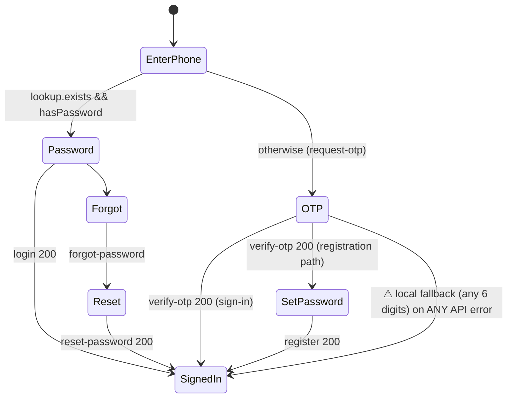

# Module: Authentication and Account

**Purpose:** let borrowers create an account and sign in (phone OTP, password, mock Google), reset passwords, and give staff (in demo mode only) role tokens.

## Files and symbols
| Layer | File | Symbols |
|---|---|---|
| UI | `frontend/src/components/Step2Auth.tsx` | `authMode` states (`signin_*`, `reg_step1..3`, forgot / reset), `handlePasswordSignIn`, `handleGoogleSignIn`, OTP verify (~`:385-416`), `handleRegStep3Submit` (~`:418+`) |
| Client API | `frontend/src/services/api.ts` | `authTokens`, `lookupPhone`, `requestOtp`, `verifyOTP`, `loginWithPassword`, `register`, `loginWithGoogleDemo`, `forgotPassword`, `resetPassword`, `logout` (unused), `ensureStaffToken` |
| Client local store | `frontend/src/services/storage.ts` | `findUserByPhone`, `registerUser`, `loginWithPassword`, `loginWithGoogle`, `generateOTP`, `verifyOTP`, `getCurrentUser`, `logout` |
| Server | `backend/server.js` | `sanitizeUser`, `signUserToken`, `signStaffToken`, `readToken`, `authenticate`, `optionalAuth`, `requireStaff`, `canAccessUser`, `otpStore`, routes `:386-614` |
| Server delivery | `backend/services/smsService.js`, `emailService.js` | `sendSms`, `sendEmail` |

## Business rules (server-enforced unless noted)
- The phone is normalised by stripping spaces, parentheses and dashes. At least 7 digits are required for an OTP.
- OTP: 6 digits, 5 minutes, at most 5 failed attempts per issued code, single use.
- Password: at least 8 characters (server). The client shows stricter rules (`isPasswordValid`), which are not enforced on the server.
- Registration requires a phone-verified JWT whose `phone` claim matches.
- Reset code: 6 digits, SHA-256 at rest, 15 minutes, 5 attempts. Issuing a new code invalidates earlier ones.
- An email can belong to only one account (UNIQUE, plus a case-insensitive pre-check at registration).
- `users.isActive` is **not** checked anywhere (Verified), so accounts cannot be disabled.

## Flows

## Error states and edge cases
- An expired or used OTP returns 400, and too many attempts returns 429, but the **client then tries local verification** (SEC-05).
- The server restarting clears every pending OTP, so users must request a new code.
- A Google-demo user has `phoneNumber = 'google:<email>'`, so reset SMS is skipped (`server.js:567`).
- A borrower JWT expires after 7 days. The client stops sending it within 5 s of expiry, but the local session continues (see [mobile-application.md](../mobile-application.md#5-platform-capabilities)).

## Permissions
Borrower JWT `type: 'borrower'`. Staff JWT `type: 'staff'` with `role`. See [security-and-privacy.md §2.3](../security-and-privacy.md#23-authorization-verified).

## Dependencies
Notifications (SMS), Loan application (the active draft is loaded after login), Back office (staff tokens).

## Tests (existing)
- `test_verification.js` §1 (register and first application), §4 (document ownership with two users).
- `test_returning_user_prefill.js` §1 and §5 (isolation between users A and B).
- Both rely on demo-mode OTP behaviour.
- No tests for: expiry, the 429 attempt limit, reset-password, enumeration, behaviour with DEMO_MODE off.

## Known issues
SEC-01, SEC-04, SEC-05, SEC-06, SEC-07, SEC-08, SEC-09, SEC-13, SEC-15 ([security-and-privacy.md](../security-and-privacy.md)).

## Extending safely
- New public auth routes **must** be declared before `app.use('/api', authenticate)` (`server.js:619`).
- Do not add more `storageService` auth paths. Plan to remove them.
- For production staff auth, add a separate login that issues `type:'staff'` tokens with server-verified roles. `requireStaff` already consumes that claim shape.
