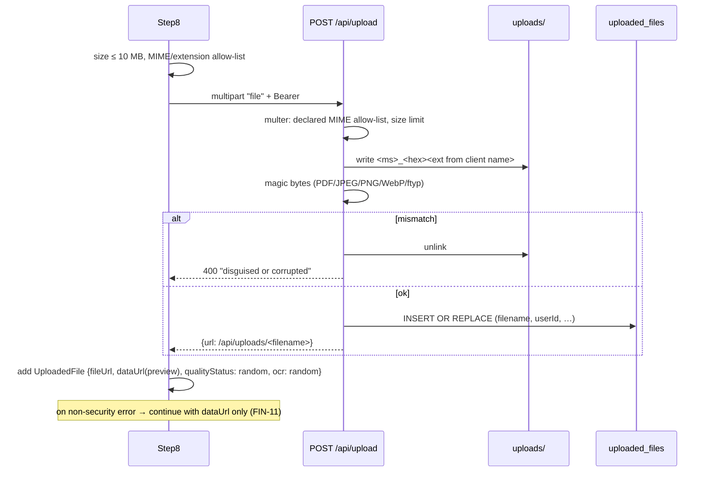

# Module: Documents and Uploads

**Purpose:** capture identity, income and bank documents (Step 8), guarantor IDs (Step 7) and requested additional documents (Step 11). Store them on the server, control access to them, and reuse valid documents for returning borrowers.

## Files and symbols
| Layer | File | Symbols |
|---|---|---|
| UI | `Step8DocumentUpload.tsx` | upload handler (`:85-210`), simulated quality and OCR (`:148-171`), camera input (`:250`) |
| UI | `Step7Guarantor.tsx` | guarantor ID upload (`:189+`) |
| UI | `Step11StatusTimeline.tsx` | `handleUploadMissingDoc` (`:107-157`) |
| Back office | `BackOffice.tsx:928` | `apiService.resolveFileUrl(doc.fileUrl, 'staff') || doc.dataUrl` |
| Config | `config/appConfig.ts:113+` | `DOCUMENT_TYPE_CONFIG` |
| Client API | `services/api.ts` | `uploadFile`, `resolveFileUrl` |
| Server | `backend/server.js` | `ALLOWED_MIME` (`:629`), `upload` multer (`:630-643`), `validateFileMagicBytes` (`:645-677`), `POST /upload` (`:679`), `GET /uploads/:filename` (`:715`), `stripInlineFiles` (`:216`), `evaluateReusableDocuments` (`:737`) |
| Schema | `backend/database.js:106-115` | `uploaded_files` |

## Document types
Required: `PASSPORT`, `PAY_SLIP`, `BANK_ACCOUNT_DOCUMENT`. Conditional: `GUARANTOR_ID`. Optional: `WORKERS_CARD`. Also defined in types: `WORK_VISA`, `EMPLOYMENT_CONFIRMATION`, `BANK_STATEMENT`, `CREDIT_CARD` (SEC-17).

## Upload pipeline

## Access control
`GET /api/uploads/:filename`: owner or staff when an ownership row exists. **Open to any authenticated caller when no row exists** (SEC-10). Images in the UI use `?token=` URLs (SEC-11).

## Reuse rules (returning borrowers)
The server (`server.js:737-793`) and the client (`storage.ts:802-849`) both drop `WORK_VISA`/`WORKERS_CARD` when the visa expires within 6 months, and drop `PAY_SLIP` when uploaded more than 90 days ago. Everything else is reused and marked `isReused`, `validityStatus:'valid'`.

## Known issues
SEC-10, SEC-11, SEC-17, FIN-09 (simulated quality and OCR), FIN-10, FIN-11. Uploads are not linked to applications, and orphaned files are never deleted. `Step11StatusTimeline.tsx:115` passes the document type as the `scope` argument of `uploadFile` (DEF-05).

## Tests (existing)
`test_verification.js` §2 (valid files and magic bytes), §3 (disguised and invalid files rejected), §4 (ownership), §7 (expired document detection). `test_returning_user_prefill.js` §2, §4, §5.
