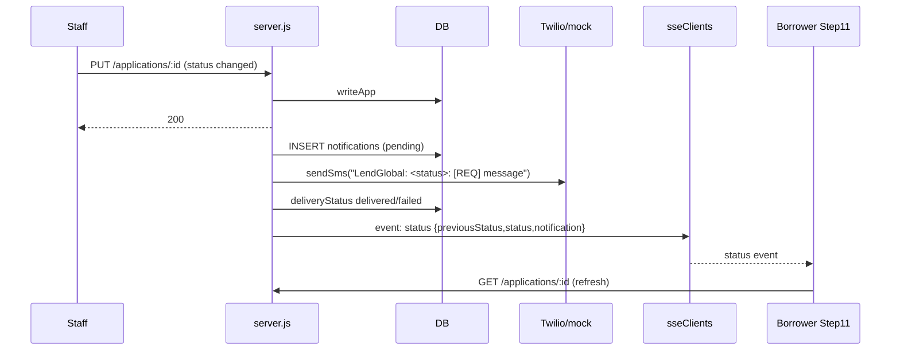

# Module: Notifications and Real-Time Status

**Purpose:** tell borrowers about submission and status changes by SMS, through an in-app notification list, and through live updates on the status timeline.

## Files and symbols
| Layer | File | Symbols |
|---|---|---|
| Server | `backend/server.js` | `createNotification` (`:328`), `STATUS_MESSAGES` (`:346`), `notifyStatusChange` (`:355`), `sseClients` / `broadcastAppEvent` (`:312-319`), SSE route (`:1082`), notification routes (`:1143-1186`) |
| Server | `services/smsService.js` | `sendSms` |
| Client | `NotificationBell.tsx` (30-second polling), `NotificationDrawer.tsx`, `Step11StatusTimeline.tsx` (EventSource) | |
| Client API | `api.ts` | `getNotifications`, `markNotificationRead`, `markAllNotificationsRead`, `openApplicationEvents` |
| Client local | `storage.ts` | `createNotification`, `getNotifications`, `markNotificationAsRead` (local duplicates) |

## Flow

## Behaviour notes
- Notification text is **English only** on the server, although `language` is stored. The client creates its own translated local notifications in parallel (`storage.ts:1091-1101, 1150-1159`), so a borrower may see both.
- `channel: 'push'` sends nothing. It is only a label.
- SSE: one Set per application id held in memory, a 25-second heartbeat, `retry: 5000`. **No event IDs and no replay**, so events missed while disconnected are lost until the next refresh. Will not work across multiple server instances.
- Sending happens after the HTTP response path (`notifyStatusChange(...).catch(...)`). Failures are logged only.

## Known issues
- No retry or outbox for failed SMS. `request-otp` ignores send failures.
- Under DEMO_MODE, `canAccessUser` allows the anonymous `demo_user` to read `demo_user` notifications.
- `POST /notifications/send-sms` is a free-form SMS relay for `system_admin` and `customer_service`.

## Tests (existing)
No direct tests of notifications or SSE.
