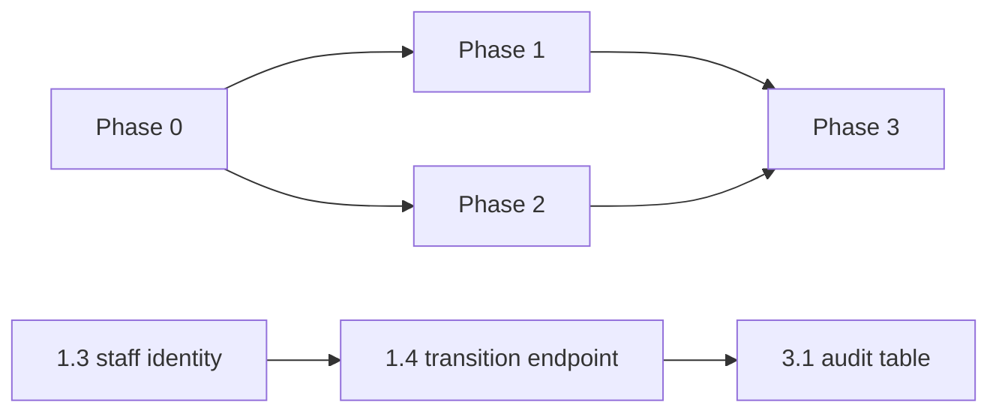

# Security Remediation Roadmap

These are recommendations. Nothing below has been implemented as part of this documentation work. Effort sizes are rough engineering estimates (S ≤ 1 day, M ≤ 1 week, L > 1 week) and need confirmation by the team.

## Phase 0: Stop-the-bleed (before any real data or any shared environment)

| # | Action | Fixes | Effort |
|---|---|---|---|
| 0.1 | Invert DEMO_MODE: enabled **only** when `DEMO_MODE=true`. Remove the `jwt.decode` fallback in `authenticate`/`optionalAuth`. Remove the no-token → `demo_user` identity. Log a prominent startup warning | SEC-01 | S |
| 0.2 | Make `/applications/:id/pdf` GET-only and read-only. Delete the auto-persist branch (`server.js:1114-1126`) and update `api.ts:235-268` to GET only | SEC-02 | S |
| 0.3 | Confirm whether `backend/database.sqlite` contains real data. Untrack it and add it to `.gitignore`. If real, purge history and follow the incident process | SEC-14 | S–M |
| 0.4 | Require `JWT_SECRET` whenever the server binds to anything other than localhost. Rotate it | SEC-13 | S |
| 0.5 | Remove client-side authentication fallbacks in `Step2Auth.tsx` and the user and password store in `storage.ts`. On sign-out call `apiService.logout()` and clear `quickloan_*` | SEC-05, SEC-06, SEC-07 | M |

## Phase 1: Authentication and authorization hardening

| # | Action | Fixes | Effort |
|---|---|---|---|
| 1.1 | Rate limiting (per IP, per phone, per account) on `request-otp`, `verify-otp`, `login`, `lookup`, `forgot/reset-password`, `upload`. Back-off and CAPTCHA. Twilio Verify or Fraud Guard with geo-permissions | SEC-08 | M |
| 1.2 | Uniform responses for lookup and login. Consider removing `lookup` | SEC-09 | S |
| 1.3 | Real staff identity: SSO/OIDC or staff accounts with MFA. Server-issued role claims. Hide the back-office entry point from borrowers | SEC-04 | L |
| 1.4 | Dedicated status-transition endpoint with a role × state matrix. Server-built history. Staff may no longer overwrite borrower sections | SEC-03, FIN-06, FIN-08 | M |
| 1.5 | Shorter access tokens (e.g. 15 min) with rotating refresh tokens in `HttpOnly; Secure; SameSite` cookies, server-side revocation and a logout endpoint | SEC-07 | M |
| 1.6 | Pin `jwt.verify` to `algorithms: ['HS256']` (or move to asymmetric keys) | Defence in depth | S |

## Phase 2: Data protection

| # | Action | Fixes | Effort |
|---|---|---|---|
| 2.1 | Upload hardening: extension from the detected type, safe `Content-Type`, `Content-Disposition: attachment`, deny when no ownership row exists, link uploads to applications, per-user quotas, optional AV scan | SEC-10 | M |
| 2.2 | Replace `?token=` with short-lived signed URLs (files) and cookie or ticket auth (SSE) | SEC-11 | M |
| 2.3 | CORS allow-list, `helmet`, CSP for the SPA, TLS at a reverse proxy, HSTS. Remove the "TLS 1.3" footer claim until it is true | SEC-12 | S–M |
| 2.4 | Encrypt at rest (DB or volume encryption, encrypted object storage for documents). Field-level encryption for passport and bank numbers | SEC-16 | L |
| 2.5 | Retention and deletion policy, plus data-subject access and deletion endpoints. Stop duplicating PII into `users.profileData`, or treat it as a governed record | SEC-16 | M |
| 2.6 | Store OTP hashes only, compare in constant time, no codes in logs | SEC-15, SEC-20 | S |
| 2.7 | Remove the `CREDIT_CARD` document type | SEC-17 | S |

## Phase 3: Evidence, audit, assurance

| # | Action | Fixes | Effort |
|---|---|---|---|
| 3.1 | Server-side, append-only audit table (actor, role, action, entity, before/after hash, IP, timestamp) | FIN-08, SEC-03 | M |
| 3.2 | Server-recorded consent (text version and hash, server time, IP, user agent) | SEC-19 | S–M |
| 3.3 | `npm audit` / Dependabot in CI. Pin the Node version | Supply chain | S |
| 3.4 | Security tests in CI (see [test-coverage-gaps.md](test-coverage-gaps.md)). External penetration test before launch | Assurance | M |
| 3.5 | Privacy impact assessment and legal review against Israeli privacy law, Amendment 13 and credit regulation | Compliance | L |

## Dependency order

