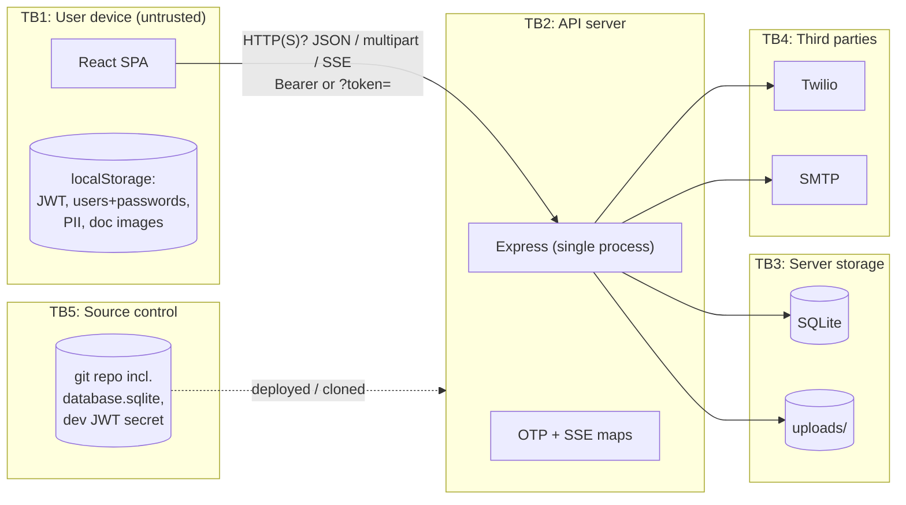

# Threat Model

Method: lightweight STRIDE over the verified architecture ([architecture.md](architecture.md)). Mitigations are listed **only where there is evidence in code**. This model contains no exploit procedures.

## 1. Assets

| ID | Asset | Sensitivity |
|---|---|---|
| A1 | Borrower identity data: passport number, date of birth, nationality, address, visa details | High (identity theft; foreign workers are a vulnerable population) |
| A2 | Identity document images (passport, visa, pay slip, bank document, guarantor ID) | High |
| A3 | Bank account details | High (fraud, redirecting disbursement) |
| A4 | Guarantor PII (third parties who never logged in) | High |
| A5 | Credit decision and status integrity | High (wrongful approval or rejection) |
| A6 | Credit-rule configuration | Medium-High (changes risk policy) |
| A7 | Credentials: passwords, OTPs, JWTs, `JWT_SECRET`, Twilio and SMTP secrets | Critical |
| A8 | SMS budget (Twilio account) | Medium (financial loss) |
| A9 | Consent and signature records | Medium-High (legal evidence) |

## 2. Actors

| Actor | Trust |
|---|---|
| Borrower (authenticated) | Trusted for their own data only |
| Anonymous Internet user | Untrusted |
| Staff: customer_service, credit_reviewer, system_admin, funding_entity | Trusted per role. **No production identity exists** (SEC-04) |
| Person sharing the borrower's device | Untrusted, with physical access |
| Malicious browser extension or XSS payload | Untrusted code inside the origin |
| Operator with server or repo access | Privileged |

## 3. Trust boundaries

## 4. Threats

| ID | STRIDE | Threat | Boundary | Assets | Evidence-backed mitigations | Gaps (finding) |
|---|---|---|---|---|---|---|
| T1 | Spoofing | Sign in as another borrower | TB1→TB2 | A1–A4 | OTP 5-min TTL, 5 attempts, random code; bcrypt passwords | DEMO_MODE accepts any code or forged token (SEC-01). No rate limit (SEC-08). Enumeration (SEC-09) |
| T2 | Spoofing / Elevation | Obtain staff privileges | TB1→TB2 | A5, A6, all PII | `requireStaff` on staff routes | Demo staff-token issuance and unverified JWT decode (SEC-01). Back-office toggle visible to all users (`Header.tsx:163-179`) |
| T3 | Tampering | Create or alter application records outside the rules | TB2 | A5 | Borrower immutability after submission; server-side scores | PDF route persistence (SEC-02). No server validation of terms (FIN-04). Staff overwrite (SEC-03) |
| T4 | Tampering | Forge the audit trail | TB2 | A5, A9 | — | Client-supplied `statusHistory` (SEC-03). Client-only audit log (FIN-08) |
| T5 | Repudiation | A borrower disputes consent or signature | TB1→TB2 | A9 | Consent records stored in the application | IP hard-coded, built on the client, no server timestamp (SEC-19) |
| T6 | Info disclosure | Read another user's application or documents | TB2→TB3 | A1–A4 | `canAccessUser` on every owner route; `path.basename` on files | Demo bypass (SEC-01). Legacy files with no ownership row (SEC-10) |
| T7 | Info disclosure | Data harvested from a shared or lost device | TB1 | A1–A4, A7 | — | Plaintext passwords and PII in localStorage (SEC-06). JWT kept after sign-out (SEC-07) |
| T8 | Info disclosure | Repository leak | TB5 | A1–A4, A7 | `.gitignore` excludes `.env*` and uploads | DB committed (SEC-14). Dev secret in source (SEC-13) |
| T9 | Info disclosure | Token leakage through URLs and logs | TB1/TB2 | A7 | — | `?token=` on GET (SEC-11). OTPs in mock logs (SEC-15, SEC-20) |
| T10 | Tampering / XSS | Malicious upload served from the API origin | TB2 | A7, A1 | MIME allow-list, magic bytes, `nosniff`, random filenames | Extension and Content-Type derived from client input (SEC-10) |
| T11 | DoS / financial | SMS pumping, OTP flooding | TB2→TB4 | A8 | — | No rate limit or CAPTCHA (SEC-08) |
| T12 | DoS | Upload disk exhaustion; large JSON bodies; SSE connection exhaustion | TB2 | Availability | 10 MB upload cap, 5 MB JSON cap | No quotas. Unbounded SSE clients. Single process |
| T13 | Info disclosure | Cross-origin abuse | TB1→TB2 | All | Bearer tokens are not sent automatically, which limits CSRF | `cors()` allows any origin (SEC-12) |
| T14 | Tampering | Misleading UI states (fake success, fake funding, fake digest) | TB1 | A5 | — | FIN-01, FIN-07 |

## 5. Highest-priority attack paths (described, no instructions)

1. **A misconfigured environment is fully open.** Deploying without `NODE_ENV=production` enables every demo bypass at once (T1, T2, T6).
2. **Record injection through a non-mutating endpoint.** The PDF endpoint's fallback can insert arbitrary application records (T3).
3. **Shared-device carry-over.** The token survives sign-out, and the local OTP fallback lets the next person act inside the previous user's session (T7, T1).

## 6. Recommended controls

See [security-remediation-roadmap.md](security-remediation-roadmap.md).
