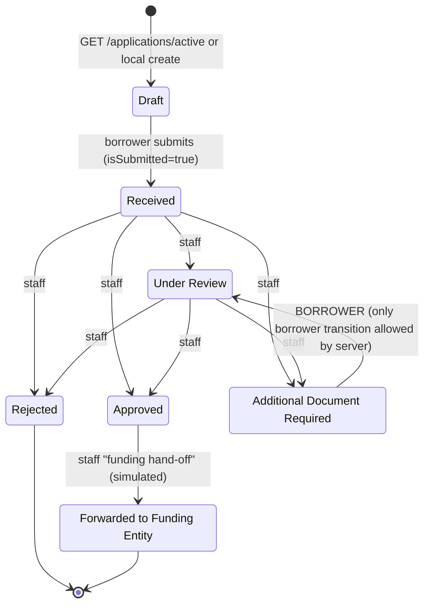
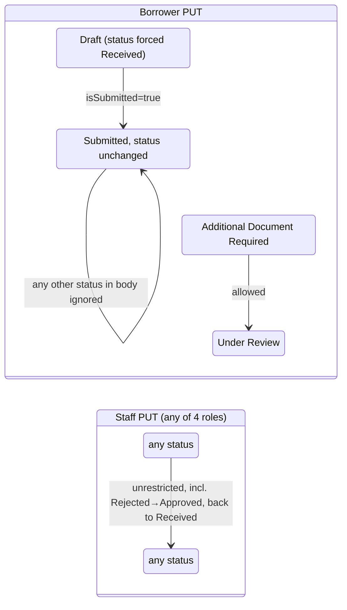

# Application State Models

The only stateful business entity is the **loan application**. There are no payment or transaction entities (see [financial-workflows.md](financial-workflows.md)).

## 1. Canonical statuses (Verified)

Defined in `frontend/src/types.ts:3-9`. The server uses the same strings in `OPEN_STATUSES` and `DECIDED_STATUSES` (`server.js:38-39`) and in `STATUS_MESSAGES` (`server.js:346-353`).

| Status | Open? | Decided? | Borrower SMS text (server) |
|---|---|---|---|
| Received | ✓ | | Queued for review. On first submission: "Your request number is …" |
| Under Review | ✓ | | A credit officer is reviewing |
| Additional Document Required | ✓ | | `missingDocumentNotes`, or the generic text |
| Approved | ✓ | ✓ | Congratulations |
| Rejected | | ✓ | Not approved |
| Forwarded to Funding Entity | ✓ | ✓ | Sent to funding partner for disbursement |

A separate boolean, `isSubmitted`, distinguishes drafts from submissions. While `isSubmitted = false` the server forces `status = 'Received'` (`server.js:1018-1021`).

## 2. Intended lifecycle (inferred from UI actions)

## 3. What the server actually enforces (Verified)

| Actor | Enforcement | Evidence |
|---|---|---|
| Borrower, draft | Status forced to `Received`, history cleared | `server.js:1018-1022` |
| Borrower, first submit | Status `Received`, server `submittedAt`, only borrower history kept | `server.js:1008-1017` |
| Borrower, after submit | Status and history frozen, except `Additional Document Required → Under Review` | `server.js:981-1007` |
| Staff (any role) | **None.** Any status, any history, any field | `server.js:975-977` |
| PDF route on an unknown id | **None.** Any status persisted (SEC-02) | `server.js:1115-1126` |

Role-to-action mapping in the UI only (`BackOffice.tsx`):
- Approve, Request Document and Reject: `credit_reviewer`, `system_admin` (`:1032-1067`)
- Funding hand-off: `funding_entity`, `system_admin`, `credit_reviewer` (`:1070-1079`). **The button checks only the role, not the current status.** The UI therefore allows "Forwarded to Funding Entity" from *any* status, including `Received` or `Rejected` (Verified by reading the JSX condition)
- None of these buttons check the current status. Approving an already rejected application is possible from the UI

## 4. Side effects of a transition

| Event | Side effects |
|---|---|
| First submission | Risk and eligibility score, request number, `notifications` row, SMS, SSE `status`, `users.profileData` update |
| Status change (submitted → submitted, different status) | `notifications` row, SMS, SSE `status` |
| Save of a submitted app, same status | Risk re-score, SSE `updated` |
| Credit-rule update | Risk re-score of every submitted app. No notification |

Side effects are not transactional. The notification runs after the response path begins (`notifyStatusChange(...).catch(...)`, `server.js:1072`), so a crash after `writeApp` can leave a status change with no notification.

## 5. Pending, failed and ambiguous states

| Scenario | What happens today |
|---|---|
| Submission PUT fails (network, 401, 500) | Client shows submitted. Server keeps a draft or nothing (**ambiguous, undetected**) |
| Submission PUT succeeds but the response is lost | Client shows submitted (correct). Request numbers may differ (FIN-02) |
| Staff status PUT fails | Local copy changed, server unchanged, toast shows success |
| SMS send fails | `notifications.deliveryStatus = 'failed'`. No retry |
| SSE disconnected | `sseConnected=false` indicator. Browser auto-reconnects (server sends `retry: 5000`). Missed events are **not replayed**. A refresh happens only on the next event or a reload |

No `pending`, `failed` or `reversed` application states exist. No reconciliation job compares client and server.

## 6. Recommended target model

1. A server-side transition table, `allowed[fromStatus][role] → toStatus[]`, enforced in a dedicated `POST /applications/:id/transitions` endpoint.
2. The history entry is built on the server from `req.auth` (actor id and role), together with the server timestamp and reason.
3. A `version` column with an `If-Match` precondition.
4. An outbox table for notifications and SMS (at-least-once delivery with retry).
5. A real funding integration as server-side states: `Approved → FundingRequested → FundingAccepted | FundingFailed`, with persisted external references and reconciliation.
